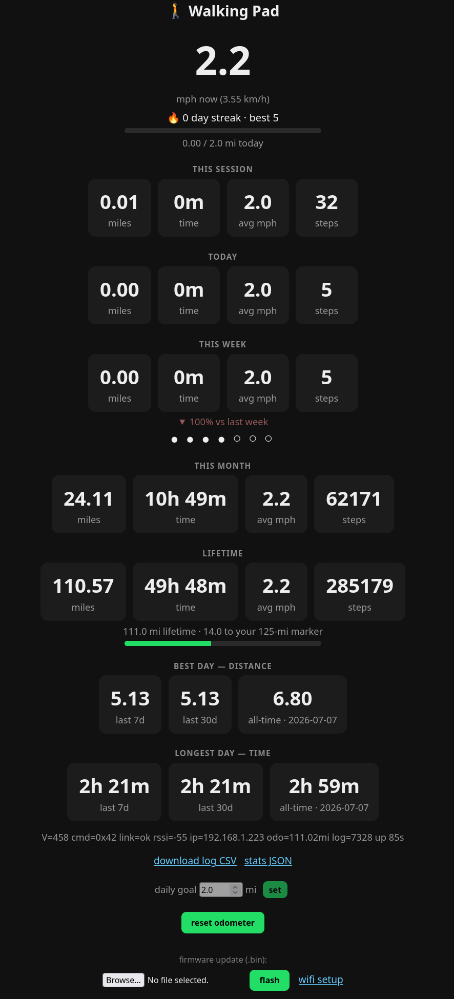
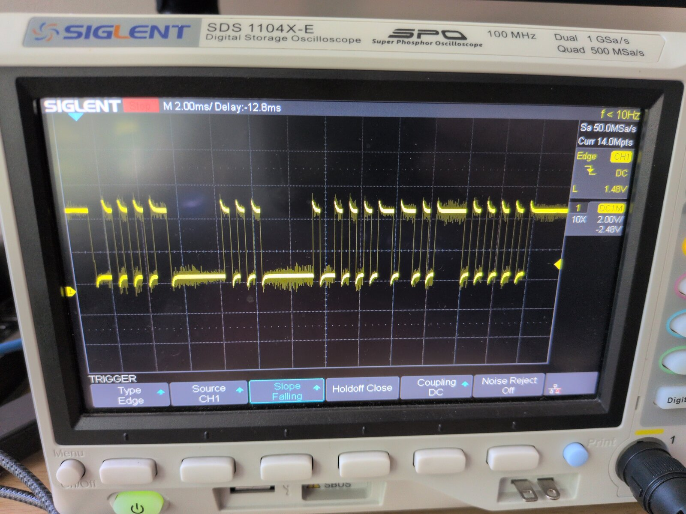
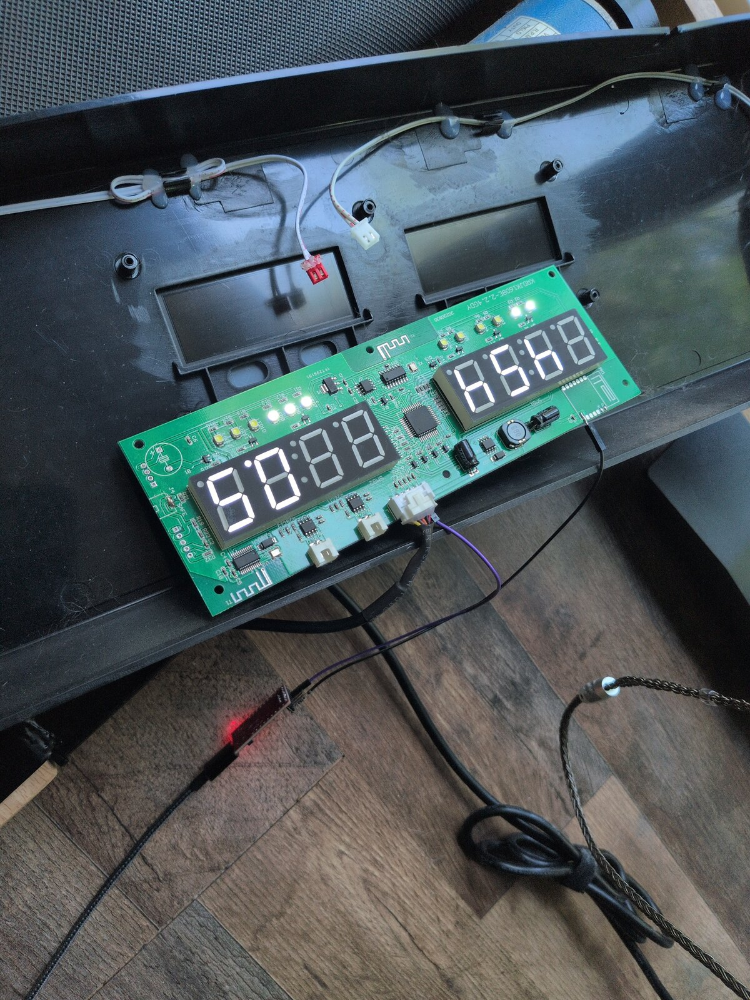

# Walking Pad Telemetry Bridge

I have a cheap, unbranded under-desk walking pad whose only wireless feature was a Bluetooth
speaker. I reverse-engineered its internal serial link and added a WiFi telemetry board: an
ESP32 sealed inside the pad listens to the console's speed commands and serves a live dashboard,
a JSON API, and a persistent walking history with a few motivational extras.

> **About this project.** This is a portfolio piece showing how I use
> [Claude Code](https://claude.com/claude-code) for hardware and embedded work. It isn't a product,
> and nobody else is expected to build it, since it's tied to one specific pad. **Claude Code wrote
> nearly all of the code and docs in this repo** and handled the software side of the
> investigation. Every commit carries a `Co-Authored-By: Claude` trailer. My part was the physical
> work, the direction, and the ground truth. I opened and probed the pad, wired the tap, ran the
> pad during captures, chose what to build, and tested it on real walks. The split is laid out in
> [How it was built](#how-it-was-built-with-claude-code).

## What it does

- Decodes the pad's internal **2400-baud console→drive UART** to get live speed, with no
  modification to the pad's own electronics (the tap only listens).
- Calculates distance and estimated steps, keeps an odometer that survives reboots, and logs every
  speed change to flash in a bounded circular log that holds years of history.
- Serves a phone-friendly **dashboard** at `http://walkingpad.local/` showing current speed and
  miles · time · avg mph · steps for this session, today, this week, this month, and lifetime.
- Adds some light **gamification**: a daily goal with a progress bar, a streak counter, personal
  bests (7-day / 30-day / all-time), week-over-week momentum, and lifetime distance milestones.
- Was **built to be sealed**. It updates over WiFi with automatic rollback, keeps a USB-only
  factory recovery image, and opens a WiFi setup access point if it can't join the network. After
  it was sealed, every later change went in over the air.

<p align="center">
  <br>
  <em>The live dashboard, served by the ESP32. By November 2026 it had logged 110+ miles and about 50 hours of walking.</em>
</p>

## The reverse-engineering story

The goal was to get speed and distance off a pad that offered no data interface at all. Two
promising paths turned out to be dead ends before the real one appeared.

**1. Bluetooth: dead end.** The pad announces "bluetooth mode", so the first hope was a
BLE fitness service. Claude Code ran BlueZ on my Linux PC. A power-cycle test (I switched the pad
off and on while it watched scans) showed which device was the pad. Pairing and an SDP browse
returned the complete service list: A2DP audio sink, AVRCP, and PnP info. There was no serial
profile, no BLE, and no vendor service. The modalias company ID (`0x05D6`) identified a **Jieli**
Bluetooth-audio SoC, so the Bluetooth is only a speaker.

**2. Teardown.** I opened the console. The board is `KRDJK1608E-2.2.4GDY`:

| Chip | What it is | Role |
|---|---|---|
| SC95F7616BP | SinOne 1T 8051 MCU, 5 V | Drives the LCD, commands motor speed, counts steps. All telemetry starts here. |
| AC223…RYD + trace antenna | Jieli BT-audio SoC | The "bluetooth mode" speaker. Audio only. |
| Sanded SOIC-16 + SOIC-8 flash | Marking removed | Most likely voice prompts. |
| **Unpopulated 14-pin footprint + trace antenna** | Tuya/ESP8285 WiFi-module socket | The "smart" SKU's WiFi option, with a 5 V UART routed to the MCU. |

**3. The empty WiFi socket: also a dead end.** With the console powered on the bench (9 V on the
main connector, away from mains), it shows error **E07**, which is expected without the drive
board. Claude Code wrote a script that sent Tuya heartbeat and query frames through a 5 V FTDI
adapter, sweeping baud rates. Nothing answered. To rule out E07 or reversed pins as the cause, I
reassembled the pad and ran the belt, and we tried both pin orientations at every baud rate. It
stayed silent. This SKU's firmware simply never starts the WiFi task.

**4. The console↔drive link.** The real data is on the 5-pin connector between the console and the
motor-drive board:

| Pin | Signal |
|---|---|
| 1 | GND |
| 2 | +12 V |
| 3 | ~3.6 V static |
| 4 | data, drive→console (a keepalive) |
| **5** | **data, console→drive: the speed command** |

On the scope, pin 5 showed an 831 µs period. That is a two-bit cycle, so a bit lasts about 415 µs,
which means **2400 baud**. Capturing at 2400 8N1 produced 36 out of 36 identical, cleanly framed
packets.

<p align="center">
  <br>
  <em>A frame on the console↔drive data line (Siglent SDS1104X-E, 2 ms/div). The bit timing gave the baud rate.</em>
</p>

**5. Decoding the frames.** `tools/framemon.py` prints a frame only when it changes and puts carets
under the bytes that moved. I stepped the speed up 0.1 mph at a time and called out each value
while it watched. Two bytes moved in lockstep with the display, and seven data points fit a straight
line exactly:

```
AA  <cmd>  <HH>  <LL>  <CK>  55
│    │      └──┬──┘     │     └─ trailer
│    │         │        └─────── checksum = (cmd + HH + LL) & 0xFF
│    │         └──────────────── V = HH·256 + LL
│    └────────────────────────── 0x42 = run at speed; 0x40 / 0xA2 / 0x50 = idle
└─────────────────────────────── header

mph = (V − 105) / 160         e.g. V=185 → 0.5 mph, V=281 → 1.1 mph
```

`tools/speedo.py` then checked the formula live against the console display.

<p align="center">
  <br>
  <em>Bench capture: the console board opened up and powered, with a 5 V FTDI adapter (red LED, bottom left) tapped onto its serial lines.</em>
</p>

**6. What's missing from the wire.** Distance isn't sent; the console just integrates speed over
time, so the bridge does the same. **Steps aren't sent either.** The console counts real footfalls
from a dedicated sensor and only displays them. The bridge therefore estimates steps from distance
and a stride length. The stride was later calibrated against the console's own count. The first
estimate was 4424 steps against the console's 4752; after calibration it came out at 4750.

## The tap

Pin 5 carries 5 V logic, and the ESP32 is a 3.3 V part. The intended design is a passive divider
that only listens:

```
pad pin 5 ──[ 4.7k ]──┬──► ESP32 GPIO16 (UART2 RX)
                      │
                    [ 10k ]
                      │
pad pin 1 (GND) ──────┴──── ESP32 GND          pad 5 V rail ──► ESP32 VIN
```

Three hardware lessons came out of this:

- **An active level shifter broke the pad.** A TXS0108E bidirectional shifter back-drove pin 5
  while the ESP32 booted, corrupting the console↔drive handshake and causing E07. A passive,
  receive-only tap avoids that, and the firmware never assigns a TX pin to this UART.
- **Safety check before grounding anything to the PC:** we confirmed the pad's logic ground is
  isolated from mains before connecting a USB-grounded FTDI to it.
- **As built, the divider was skipped.** In the sealed unit, pin 5 goes straight into GPIO16, which
  relies on the ESP32's unofficial 5 V tolerance. That is out of spec: UART idles high, so 5 V sits
  on the pin's ESD clamp continuously. It works, and it's documented as the first thing to suspect
  if reception ever becomes flaky.

## Firmware design

The firmware is ESP-IDF 5.4 C on a classic ESP32 (WROOM), all in one file:
[`main/walkingpad_bridge.c`](main/walkingpad_bridge.c).

```
pad pin 5 ─► UART2 RX ─► uart_task ── frame sync (AA…55 + checksum) ─► speed
                             ├─ ∫ speed·dt ─► odometer / session / lifetime counters (NVS)
                             └─ settled speed change or 4-min heartbeat ─► circular log (LittleFS)

HTTP server:  /  dashboard     /status  live JSON        /stats  history rebuilt from the log
              /log.csv         /goal    daily goal       /update OTA (raw .bin)    /setup WiFi
```

- **Unattended operation.** The flash holds a USB-only golden `factory` image plus two OTA slots
  that alternate, and an image that never comes up healthy rolls back automatically. If the device
  can't join WiFi within 30 s, it opens a setup access point where new credentials can be entered.
  mDNS makes it reachable as `walkingpad.local`.
- **Bounded storage.** Each speed change becomes an 8-byte timestamped record in a six-segment
  circular log on a ~960 KB LittleFS partition. When a segment fills, the oldest one is erased.
  Storage can't fill up, and the log holds about four years at normal use.
- **History is rebuilt from the log, not accumulated.** `/stats` replays the log on each request.
  It buckets by the **local** calendar (US Eastern, DST-aware) and filters out power-off gaps.
  Timestamps stay in UTC epoch.
- **Gamification state is split by what it depends on.** Streaks depend on the goal, so they're
  always recomputed from a 370-day window and changing the goal re-derives them. All-time records
  are saved to flash, because the circular log eventually drops the days they came from.
- **Minimal stack.** There's no framework. The dashboard is a single HTML/JS string compiled into
  the firmware, and the JSON is built by hand.

The full API, JSON fields, log format, and operations runbook are in
[`docs/REFERENCE.md`](docs/REFERENCE.md).

## How it was built with Claude Code

Development took about a day of real time (July 1–2, 2026), split between bench work and remote
iteration once the unit was sealed.

| Me | Claude Code |
|---|---|
| Picked the problem and did all the physical work: opening the pad, bench-powering the console, connecting the FTDI, probing with a scope | Drove the Bluetooth investigation through BlueZ and wrote the capture and probing scripts |
| Ran the pad and called out display values during captures | Interpreted the scope timing and decoded the frame format, checksum, and speed formula |
| Soldered the tap, installed the ESP32, and sealed the pad | Wrote the ESP32 firmware, the web dashboard, and the bench tools |
| Made the product decisions, such as which stats to show, which gamification features to add, and using distance as the goal metric | Built, flashed, and OTA-deployed each change, then checked it against the live JSON API |
| Supplied ground truth, like the console's real step count for calibration, and tested on real walks | Wrote the docs, the commit messages, and [`CLAUDE.md`](CLAUDE.md) |

Some things made this work better than "paste code, try it, report back":

- **Hardware in the loop.** A small set of local Claude Code skills (`mcu-detect`, `mcu-build`,
  `mcu-flash`) wrap ESP-IDF and esptool. With them, Claude Code could find boards by USB vendor ID,
  build, flash at a baud rate this board tolerates, and read the serial console. It iterated on the
  real board instead of handing me code to try.
- **An observable device.** After the unit was sealed, OTA plus the JSON API let Claude Code check
  the device without me. Each change was built, pushed over WiFi, and confirmed by reading
  `/status` and `/stats`. For example, it checked that the odometer survived a reboot and that the
  streaks matched the log.
- **Persistent context.** Memory notes and `CLAUDE.md` carried pinouts, decisions, and gotchas from
  one session to the next.

**Timeline** (from the commit history):

| When | Milestone |
|---|---|
| Jul 1, afternoon | Bluetooth and WiFi-socket dead ends, teardown, protocol decoded at the bench |
| Jul 1, evening | First firmware: decode, dashboard, OTA, mDNS, setup AP, odometer (`2b4cc26`) |
| | Persistent circular log with SNTP timestamps (`b37ba86`); the last USB flash |
| | Sealed into the pad and checked on a real walk (`17704d1`) |
| Jul 2 | Day/week/month on local time (`ea1cc3f`): everything over OTA from here |
| | Live session stats (`12cdc47`), stride calibration (`475d83d`), uniform stats grid (`f4b7856`) |
| | Gamification (`ca32e8c`) |

**Problems we hit along the way:**

- The TXS0108E level shifter caused E07 (see [The tap](#the-tap)).
- This ESP32 board has a **marginal crystal**. Some boots derived the clock from 26 MHz, which
  shifted every baud rate. The fix was to pin the crystal setting to 40 MHz and flash at 115200.
- The first gamification build saved the longest streak to flash. Lowering the goal then inflated
  it, so streaks are now always recomputed from the log window.
- The emoji escapes (`\u…`) inside the dashboard's JavaScript have to be double-backslashed inside
  the C string literal. Otherwise the C compiler reads them as its own universal character names.

## Known limitations

- **No authentication.** This is a LAN-only toy, so OTA, the resets, and goal changes are open to
  anything on the network, or on the setup AP while it's active.
- The tap is **out of spec** as built (see above).
- **Steps are estimates**, calculated as distance divided by a calibrated stride.
- It's specific to this pad's protocol, this ESP32 board, and US Eastern time.

## Repository layout

```
main/walkingpad_bridge.c   firmware: UART decode, logging, stats, HTTP, WiFi/OTA
main/idf_component.yml     managed components (mdns, littlefs)
partitions.csv             factory + ota_0 + ota_1 + LittleFS "storage"
sdkconfig.defaults         board-specific config (40 MHz XTAL, 4 MB flash, rollback)
tools/framemon.py          bench: raw frame monitor that highlights changed bytes
tools/speedo.py            bench: live decoder/speedometer over an FTDI
docs/REFERENCE.md          API, log format, build/flash/OTA, recovery
media/                     dashboard screenshot and bench photos
CLAUDE.md                  project guide Claude Code reads at the start of each session
```

## Building

Standard ESP-IDF 5.4 project. WiFi credentials (and optionally the setup-AP password) go in a
gitignored `main/wifi_secrets.h`:

```c
#pragma once
#define WIFI_SSID      "YourNetwork"
#define WIFI_PASS      "YourPassword"
#define SETUP_AP_PASS  "something-else"   // optional; 8–63 chars
```

```bash
idf.py set-target esp32 && idf.py build
idf.py -p /dev/ttyUSB0 -b 115200 flash                                    # first flash, over USB
curl --data-binary @build/walkingpad_bridge.bin http://walkingpad.local/update   # after that, OTA
```

[`docs/REFERENCE.md`](docs/REFERENCE.md) has the rest: recovery, the partition layout, and the
bench tools.
